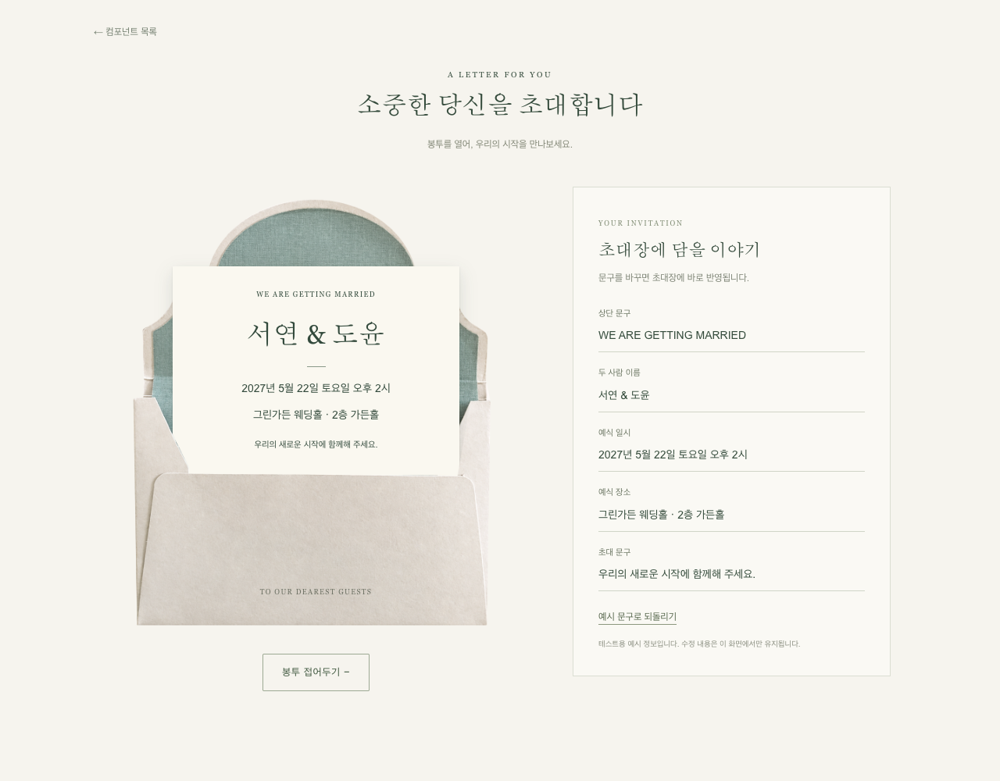

# WeddingEnvelope

테스트 화면: `/test/envelope` (`/test` 목록에도 등록).

```tsx
import WeddingEnvelope from '@/components/envelope/WeddingEnvelope';

<WeddingEnvelope overview={{
  heading: 'WE ARE GETTING MARRIED',
  names: '서연 & 도윤',
  date: '2027년 5월 22일 토요일 오후 2시',
  venue: '그린가든 웨딩홀 · 2층 가든홀',
  message: '우리의 새로운 시작에 함께해 주세요.',
}} />
```

`defaultOpen`으로 초기 상태를, `open`과 `onOpenChange`로 외부 제어 상태를 지정할 수 있습니다. 초대장은 재단되지 않은 직사각형 HTML 카드이며 모든 문구는 props로 전달합니다. 테스트 편집기는 화면 내 상태만 수정하며 저장하지 않습니다. 키보드 버튼 조작, 펼침 상태 안내, 모션 감소 설정을 지원합니다.

## 메인 화면 인트로

`introduction`을 전달하면 별도 토글 버튼 대신 봉투 영역 전체가 열기 버튼이 됩니다. 편지지가 뷰포트 전체로 펼쳐지고 열림이 완료되면 `onOpened`를 호출합니다. 메인 화면은 이 시점에 배경색이 같은 본문으로 전환하고 스크롤을 허용합니다. 테스트 화면의 기존 열기·닫기 동작은 유지합니다.

## 열림·닫힘 모션

열 때는 덮개 열기(850ms), 편지지 꺼내기(750ms), 편지지를 컴포넌트 영역 전체 너비와 높이로 펼치기(850ms) 순서로 진행합니다. 마지막 단계에서 봉투는 아래로 내려갑니다. 닫을 때는 편지지 축소와 봉투 복귀, 편지지 넣기, 덮개 닫기를 역순으로 진행합니다. 전환 중에는 버튼이 비활성화되며, 모션 감소 설정에서는 즉시 전환합니다.

## 이미지

원본: https://www.figma.com/design/LHHmUQPy7B6zp5P0qe1nOJ/ranio?node-id=25-119

`public/images/envelope/reference.png`: Figma 원본.
`blank.png`: built-in imagegen으로 원본 문구를 제거한 소스.
`flap.png`: 흰 테두리와 녹색 안감이 있는 덮개 안쪽 면. 원본 좌표 y=590의 접힘선을 기준으로 분리합니다.
`closed-reference.png`: 사용자가 제공한 닫힌 봉투 원본(다운로드 파일 `02_25_56.png`).
`flap-outside-reference.png`: 닫힌 원본에서 직접 추출한 덮개 바깥 면. 종이 질감, 가장자리 하이라이트와 주변 그림자를 함께 보존하고, 접힘선 양 끝을 기존 봉투의 x=76..1055에 맞춰 정렬합니다. 리사이즈는 `fit: fill`로 수행해 기본 cover 모드의 가로 잘림과 확대를 방지합니다. 현재 컴포넌트가 사용하는 에셋입니다.
`flap-outside.png`: 이전에 확대 종이 질감으로 만든 바깥 면으로, 현재는 사용하지 않습니다.
`back.png`: 녹색 안감이 있는 뒷면.
`front.png`: 초대장을 가리는 흰색 앞면과 양옆 접힘.

원본은 한 장의 사진이므로 문구 제거본은 AI 편집본이며 원본과 픽셀이 동일하지 않습니다. 녹색 면은 봉투 몸통과 덮개에 붙은 안감이며, 꺼내지는 HTML 편지지는 추가 연출입니다. 덮개 바깥면은 새 이미지를 생성하지 않고 제공된 닫힌 원본을 마스크로 추출합니다. 덮개 양면은 하나의 회전 요소에 배치하고, 전용 부모에 원근을 적용합니다. Z 순서는 뒷면(0), 편지지(1), 앞면(2), 앞면 문구(3)입니다. 덮개는 닫힘과 회전 중에는 4이며, 완전히 열린 뒤부터 편지지가 다시 들어갈 때까지는 0으로 내려 편지지 뒤에 놓습니다.

이미지 편집 프롬프트 (built-in imagegen):

> Use case: precise-object-edit. Edit this exact reference photograph as a source asset for an animated wedding envelope. Remove ALL lettering everywhere (black calligraphy on green flap, small black letters on green center, black text at bottom white pocket). Inpaint with identical natural paper/linen textures. Keep EXACT same composition, silhouette, crease location, green lining, ivory border, white front pocket, camera angle and background. No new elements. Preserve all envelope geometry and color, change only text removal. Output clean blank envelope in same portrait aspect ratio.

레이어 재추출: 프로젝트 루트에서 `node components/envelope/scripts/split-assets.mjs`.

## 화면 확인

Playwright로 열기·문구 편집·초기화·닫기와 모바일 가로 넘침을 확인했습니다.


